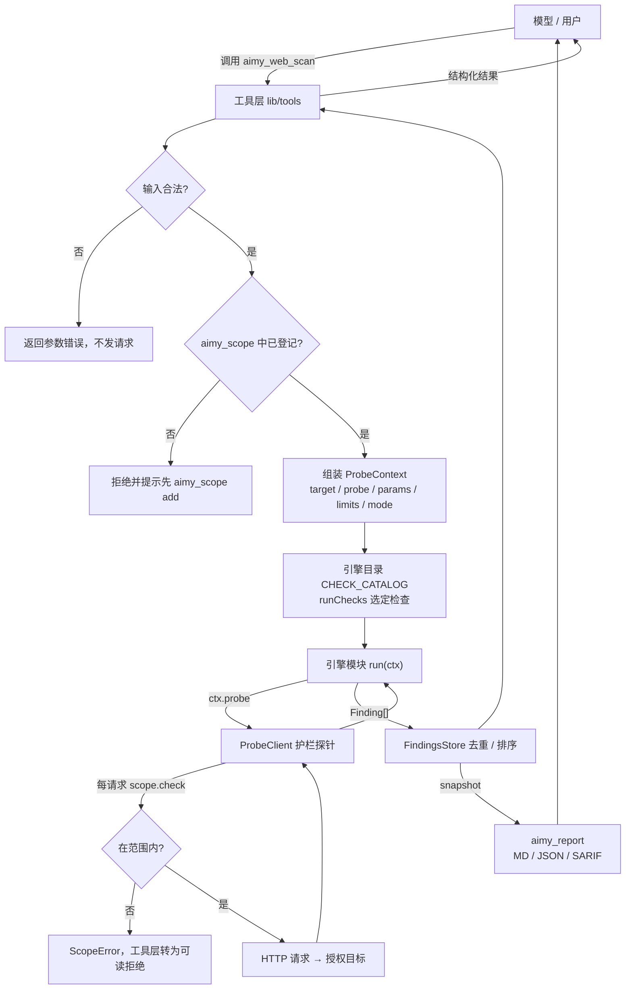
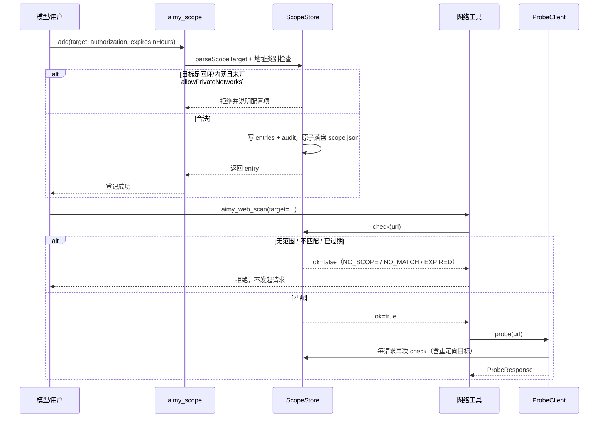
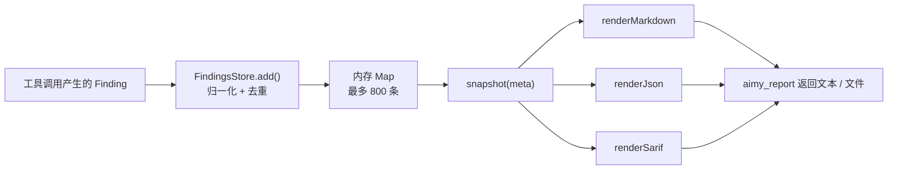

# 架构说明 · dsh-daiyi-aimy-skill

> 本文说明插件「由哪些层组成、一次工具调用怎么流动、加一个新检测模块要改哪里」。
> 面向维护者；只想用插件请读 [README.zh.md](../README.zh.md)，想看参数请读 [TOOLS.md](TOOLS.md)。

## 1. 设计目标与不变量

四条硬约束决定了整个架构：

1. **deny-by-default**：没有登记授权范围时，任何网络工具都不可用。
2. **单一出口**：插件内只有 `lib/http.js` 的 `ProbeClient` 能调用 `fetch`。引擎模块拿到的是注入的 `ctx.probe`，拿不到 `fetch`，因此不存在「绕过护栏」的代码路径。
3. **只检测**：不写文件、不落库、不反弹 shell、不横向、不做带外回连。所有 payload 都是无害 marker 或受限时延。
4. **永不拖垮宿主**：`apply()` 不抛异常；单个工具或技能注册失败只降级告警；网络失败以 `status: 0` + `error` 返回，不向上抛。

运行时**零第三方依赖**：只用 `node:` 内置模块。`@deepseek-ai/dsh-tools`、`@deepseek-ai/dsh-skill`、`@deepseek-ai/cordis` 是宿主提供的可选 peer。

## 2. 分层

```text
┌──────────────────────────────────────────────────────────────────────┐
│ 宿主（DeepSeek Harness / Cordis）                                      │
│  ctx.tools  ctx.skills                                                │
└───────────────▲──────────────────────────────────────────────────────┘
                │ 注册 / 调用
┌───────────────┴──────────────────────────────────────────────────────┐
│ 1. 插件入口层  lib/index.js + lib/config.js                           │
│    name / inject / apply；配置归一化；单例 ScopeStore + FindingsStore； │
│    注册 8 个工具与 8 个技能                                            │
└───────────────▲──────────────────────────────────────────────────────┘
                │ 工具调用（参数已由宿主按 output/parameters 校验）
┌───────────────┴──────────────────────────────────────────────────────┐
│ 2. 工具层  lib/tools/*.js                                             │
│    参数归一化 → scope 闸门 → 组装 ProbeContext → 调引擎 → 存 Finding   │
│    → 返回结构化结果                                                    │
└───────────────▲──────────────────────────────────────────────────────┘
                │ ctx.probe(url, init)
┌───────────────┴──────────────────────────────────────────────────────┐
│ 3. 引擎层  lib/engine/**                                              │
│    检测模块导出 meta + run(ctx)，爬虫/参数/指纹另有专用入口；              │
│    只做判定，不发请求、不写盘                                            │
└───────────────▲──────────────────────────────────────────────────────┘
                │ 唯一的网络出口
┌───────────────┴──────────────────────────────────────────────────────┐
│ 4. 护栏 HTTP 探针  lib/http.js                                        │
│    ProbeClient：逐请求 scope 校验、请求预算、超时、响应体截断、         │
│    重定向逐跳复检、外部取消；并发调度 mapLimit                          │
└───────────────▲──────────────────────────────────────────────────────┘
                │ HTTP(S)
             授权目标

┌──────────────────────────────────────────────────────────────────────┐
│ 5. 存储与报告  lib/store.js + lib/report.js                           │
│    FindingsStore 去重/排序/计数/运行记录；报告 Markdown / JSON / SARIF  │
└──────────────────────────────────────────────────────────────────────┘

┌──────────────────────────────────────────────────────────────────────┐
│ 6. 技能层  lib/skills/index.js + skills/<name>/SKILL.md               │
│    零依赖 frontmatter 解析与加载；纯文档，不执行代码                    │
└──────────────────────────────────────────────────────────────────────┘
```

### 2.1 入口层 `lib/index.js`

```js
export const name = 'daiyi-aimy-skill'
export const inject = ['tools', 'skills']
export function apply(ctx, config) { /* 注册工具与技能 */ }
export default apply
```

- `inject` 声明所需服务；宿主缺少服务时不会把插件启动失败当成致命错误。
- `normalizeConfig()` 把 `cordis.patch.yml` 的 `config` 与默认值合并，非法值回退并记录 warning。
- 创建本插件实例范围内的 `ScopeStore`（可选持久化到 `scope.json`）与 `FindingsStore`（纯内存），通过闭包注入给工具。
- 逐个 `ctx.tools.register(defineTool({...}))`、`ctx.skills.register({...})`；单个失败只 `log.warn`。
- `apply` 是 `async` 函数且**永不抛异常**：范围加载失败按空范围启动，工具/技能注册失败只降级告警。插件卸载由宿主生命周期管理，本版本不额外返回清理函数。

### 2.2 工具层 `lib/tools/*.js`

8 个工具，职责是「翻译」而不是「探测」：

| 工具 | 主要职责 | 主要实现位置 |
|---|---|---|
| `aimy_scope` | 登记 / 列出 / 移除 / 清空授权范围 | `lib/scope.js` 的 `ScopeStore` |
| `aimy_recon` | DNS、HTTP 基线、robots 在工具内完成；响应头检查交给 `runChecks`，技术栈指纹交给 `fingerprint()` | 引擎目录中的 `headers`、`tech-fingerprint` |
| `aimy_port_scan` | TCP 端口连通性探测（只握手），逐端口过 scope | 工具内 `net.Socket`，不经过 `ProbeClient` |
| `aimy_dir_fuzz` | 路径枚举 + 软 404 基线，全部请求经护栏探针 | 工具内实现 |
| `aimy_crawl` | 爬取页面、链接、表单、参数、JS 接口路径 | 引擎 `crawler` 模块 |
| `aimy_web_scan` | 按 `checks` 选择检测模块并执行 | 引擎目录 `CHECK_CATALOG` + `runChecks` |
| `aimy_jwt_audit` | JWT 解码、声明与弱密钥检查（纯本地） | 工具内 `node:crypto` |
| `aimy_report` | 生成 Markdown / JSON / SARIF 报告 | `lib/store.js` 快照 + `lib/report.js` |

工具层的固定流程：

1. 归一化输入（URL、参数、checks 列表），非法输入直接返回可读错误。
2. `aimy_scope` 之外的网络工具先过 scope 闸门；未授权直接返回拒绝原因，**不发起任何请求**。
3. 组装 `ProbeContext`：`target`、`probe`（绑定到 `ProbeClient`）、`params`、`mode`、`authorized: true`、`signal`、`log`、`limits`。
4. 调用 `lib/engine/index.js` 的 `runChecks(ctx, checks)`（按 `CHECK_CATALOG` 顺序执行选中的检查）。
5. 把 `Finding[]` 交给 `FindingsStore.add()` 去重，`recordRun()` 记一条运行记录。
6. 返回结构化结果（本次新增/更新的 finding、请求数、耗时、被拒绝项等）。

### 2.3 引擎层 `lib/engine/**`

检测型模块的形状固定（`sqli` / `xss` / `cmdi` / `ssti` / `ssrf` / `nosqli` / `lfi` / `cors` / `jwt` / `graphql` / `proto-pollution` / `headers`，共 12 个）：

```js
export const meta = {
  id: 'sqli',
  title: 'SQL 注入检测',
  kinds: ['sqli'],
  cwe: 'CWE-89',
  defaultSeverity: 'high',
  minMode: 'rookie',
}

/** @param {ProbeContext} ctx */
export async function run(ctx) {
  // 只用 ctx.probe 发请求；每个 await 后检查 ctx.signal.aborted
  return [/* Finding[] */]
}
```

- **绝不自己发网络请求**，也不 `import lib/http.js`。
- 单模块总请求数 ≤ `ctx.limits.maxRequests`。
- 结果确定性：同一输入同一响应 → 同一输出；排序稳定，不用 `Date.now()` / `Math.random()` 参与判定。
- 时间盲注只在 `veteran` 且 `limits` 允许时使用，`SLEEP ≤ 5s`。

少数非检测型模块按注册表约定导出专用函数，而不是 `meta + run`：

- `crawler.js` → `crawl(ctx, options)`
- `param-miner.js` → `mineParams(ctx, options)`
- `tech-fingerprint.js` → `fingerprint(ctx)`（同时也导出 `run(ctx)`）

`lib/engine/index.js` 是注册表与调度器：`CHECK_CATALOG` 声明 check id → 模块文件；`listChecks()` 供工具参数枚举；`runChecks(ctx, checks)` 按顺序**动态 import** 并执行（单个模块缺失/报错只把该项记入 `skipped`）；`crawl()` / `mineParams()` / `fingerprint()` 是供工具直接调用的辅助入口。

### 2.4 护栏探针 `lib/http.js`

`ProbeClient` 是唯一的 **HTTP** 网络出口。`aimy_port_scan` 走 TCP connect（`node:net`），是唯一的非 HTTP 网络路径，但同样逐端口过 scope 校验。`ProbeClient` 负责：

- **scope 校验**：每个请求前调用 `scope.check(url)`；跨主机重定向逐跳复检，防止 302 把请求带出授权范围。
- **请求预算**：超过 `maxRequests` 抛 `BudgetError`，由工具层转成可读错误。
- **超时与取消**：单请求超时 + 外部 `AbortSignal` 组合；取消时抛 `CancelledError`。
- **响应体上限**：`readCapped()` 流式读取，超过 `maxBodyBytes` 即截断并 cancel 流，标记 `truncated: true`。
- **固定请求头**：默认 `User-Agent` 带插件标识与仓库地址，`accept-encoding: identity`，不透传 cookie/凭据。
- **受控并发**：`mapLimit(items, limit, worker, signal)`，任一全局失败（预算/取消）立即停止调度。

`ProbeResponse` 的关键字段：`method`、`url`、`status`（网络失败为 `0`）、`headers`（小写 key）、`body`、`elapsedMs`、`truncated`、`bytes`、`error`。

### 2.5 存储与报告 `lib/store.js` + `lib/report.js`

- `FindingsStore`：
  - 去重 key = `module | checkId | url | param | payload`；
  - 排序 = 严重度 → 置信度 → 首次发现时间；
  - 上限：默认 800 条 finding、60 条运行记录，超出丢弃最轻的；
  - `snapshot(meta)` 生成报告输入：`generatedAt`、`plugin`、`scope`、`stats`、`runs`、`findings`。
- `lib/report.js`：`renderMarkdown(report)`、`renderJson(report)`、`renderSarif(report)`。报告默认对疑似凭据脱敏（`redactSecrets: true`）。

### 2.6 技能层 `lib/skills/index.js` + `skills/**`

- `skills/<kebab-name>/SKILL.md`，frontmatter 只支持 `key: value` 标量：`name`、`description`、`whenToUse`。
- 加载器只用 `node:fs/promises`，按目录名排序保证确定性；解析失败跳过并返回 `warnings`，不抛错。
- 技能名称统一 `aimy-` 前缀，避免与宿主内置技能撞名。
- 技能是**说明文档**，不执行代码、不自动调用工具。

## 3. 数据流

### 3.1 一次检测调用的完整路径



### 3.2 授权范围的生命周期



### 3.3 报告数据流

`FindingsStore` 是唯一事实来源：



注意：finding 只存内存，插件重启即清空；只有授权范围（`scope.json`）会持久化。

## 4. 安全边界在代码里的落点

| 边界 | 落点 | 说明 |
|---|---|---|
| 网络出口唯一（HTTP） | `lib/http.js` | 引擎拿不到 `fetch`，只能调 `ctx.probe`；端口探测是独立 TCP 路径，逐端口过 scope |
| 非 HTTP 探测 | `lib/tools/port-scan.js` | 只做 TCP 握手，不发应用层数据；单次最多 1024 个端口 |
| 授权闸门 | 工具层 + `ProbeClient` | 工具层快速失败；探针层兜底逐请求复检 |
| 地址类别限制 | `lib/scope.js` | 永久拒绝 link-local / multicast / reserved；回环/内网需开关 |
| 请求预算 | `lib/http.js` | `BudgetError` 中止，防止「扫全站」 |
| 响应体上限 | `lib/http.js` | 默认 256 KiB，最大 4 MiB |
| 重定向逃逸 | `lib/http.js` | 逐跳复检 scope，不复用旧授权 |
| 凭据不落盘 | `lib/scope.js` / 工具层 | 目标不允许 `user:pass@`；不保存 token |
| 确定性 | 引擎层 | 判定不依赖随机数与当前时间 |
| 宿主稳定性 | `lib/index.js` | `apply` 永不抛异常，单项注册失败降级 |

## 5. 扩展一个新的检测模块

以新增 `open-redirect` 检测为例，按下面顺序改（**不要跨 owner 写文件**，见 [CONTRACT.md](CONTRACT.md) §1）：

1. **新建引擎模块** `lib/engine/open-redirect.js`：

   ```js
   export const meta = {
     id: 'open-redirect',
     title: '开放重定向检测',
     kinds: ['open-redirect'],
     cwe: 'CWE-601',
     defaultSeverity: 'medium',
     minMode: 'rookie',
   }

   export async function run(ctx) {
     const findings = []
     // 只用 ctx.probe；每个 await 后检查 ctx.signal.aborted
     // 命中后 push 一条符合 Finding 形状的对象
     return findings
   }
   ```

2. **遵守引擎契约**：只用 `ctx.probe`；请求数 ≤ `ctx.limits.maxRequests`；payload 用无害 marker；`evidence` ≤ 800 字符且包含可复核的观测（状态码 / `Location` 头 / 时延）。

3. **登记到注册表**：在 `lib/engine/index.js` 的 `CHECK_CATALOG` 里加一行 `{ check, moduleId, title, file, minMode }`。`listChecks()` 会自动把它暴露为 `aimy_web_scan` 的 `checks` 枚举项。

4. **接入工具**：`aimy_web_scan` 会通过 `runChecks` 自动发现并执行它，通常不需要改工具层；只有需要新的调用方式（例如独立参数、独立报告字段）时才在 `lib/tools/` 新增文件。`moduleId` 必须与模块 `meta.id` 一致，否则加载时记录 warning 并以目录为准。

5. **写测试** `test/engine/open-redirect.test.js`：注入假的 `ctx.probe`（返回预设 `ProbeResponse`），断言 finding 的 `checkId`、`severity`、`evidence`；再断言请求数不超过预算、`signal.aborted` 时提前返回。

6. **本地验证**：

   ```bash
   node --check lib/engine/open-redirect.js
   node --test test/engine/open-redirect.test.js
   npm run verify
   ```

7. **补文档**：在 [TOOLS.md](TOOLS.md) 的 `checks` 列表里加一行，在 [CHANGELOG.md](../CHANGELOG.md) 的 `Unreleased` 下记一条。

8. **补技能（可选）**：如果新检测需要判定口径，在对应 `aimy-*` 技能正文里加一节「何时报 / 何时不报」，由 skills-author 维护。

### 新增工具（而不是引擎模块）时

只有当新能力**不是**「对一个已授权目标做检测」时才新增工具（例如报告导出、范围管理）。新增工具需要：

- `defineTool({ name, description, parameters, output, execute })` 形状合法（宿主会真实编译 schema）；
- 网络类工具必须先过 scope 闸门；
- `execute` 内部捕获所有异常，返回结构化错误而不是抛；
- 在 `lib/tools/index.js` 的 `createTools()` 中登记，并补 `test/` 下的 schema 测试与 [TOOLS.md](TOOLS.md) 文档。

## 6. 目录结构

```text
dsh-daiyi-aimy-skill/
├── lib/
│   ├── index.js            # 插件入口：name / inject / apply
│   ├── config.js           # 配置归一化与 rookie/veteran 预算
│   ├── scope.js            # 授权范围：解析、匹配、持久化、审计
│   ├── http.js             # 护栏 HTTP 探针（唯一网络出口）
│   ├── store.js            # Finding 存储、去重、运行记录
│   ├── report.js           # Markdown / JSON / SARIF 渲染
│   ├── tools/              # 8 个模型可调用工具
│   ├── engine/             # 12 个检测模块 + 3 个侦察模块 + 注册表 + payloads + util
│   └── skills/             # 技能加载器
├── skills/                 # 8 个 aimy-* 技能（SKILL.md）
├── docs/                   # 本文档、TOOLS、MIGRATION、SECURITY、CONTRACT
├── scripts/                # validate-plugin.mjs 契约校验
├── test/                   # 契约测试、引擎测试、技能测试
├── cordis.patch.yml        # 插件插入声明（id: daiyi-aimy-skill）
├── package.json            # ESM，零运行时依赖
├── README.md / README.zh.md
├── CHANGELOG.md
└── LICENSE
```

## 7. 关键设计取舍

| 取舍 | 选择 | 原因 |
|---|---|---|
| 会话存储 | 纯内存 | 避免把目标数据、证据、疑似凭据写到磁盘；只有授权范围需要跨重启 |
| 引擎并发 | 顺序 + 模块内受控并发 | 保证请求可计数、结果确定、取消及时 |
| 配置 | 普通对象 + 手工校验 | 运行时不引入 schemastery 等第三方依赖 |
| 报告 | 三种格式 | Markdown 给人看，JSON 给程序，SARIF 给代码扫描平台 |
| 技能 | Markdown playbook | 模型可读、可审计、不执行任意代码 |
| 无 Web UI | 只提供工具/技能/报告 | 减少攻击面；宿主已有会话界面 |
