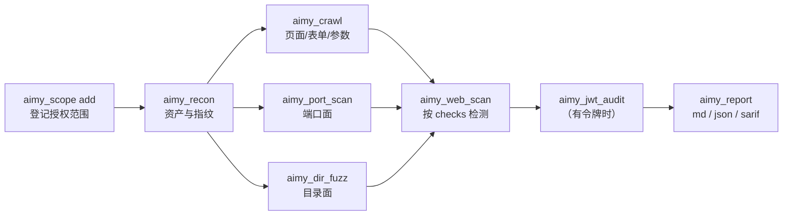

# 工具参考 · dsh-daiyi-aimy-skill

> 8 个模型可调用工具的参数、返回形状、示例与限制。
> 安全模型与范围规则见 [SECURITY.md](SECURITY.md)；架构见 [ARCHITECTURE.md](ARCHITECTURE.md)。

## 0. 通用约定

- **命名**：全部 `aimy_` 前缀 + snake_case，避免与宿主内置工具冲突。
- **授权闸门**：`aimy_scope`、`aimy_jwt_audit`、`aimy_report` 不发网络请求，不需要登记范围；`aimy_recon`、`aimy_port_scan`、`aimy_dir_fuzz`、`aimy_crawl`、`aimy_web_scan` 的目标必须已在 `aimy_scope` 中登记，否则**直接拒绝，不发任何请求**。
- **默认值**：`timeoutMs`、`maxRequests`、`concurrency`、`maxBodyBytes` 等来自插件配置；下表写的是参数级默认，没写就是「取配置值」。
- **finding 返回**：工具返回的 `findings` 是**本次新增**的发现（`accepted`）。重复观测到同一条发现不会重复返回，但会在会话存储里累加 `seen` 计数。
- **错误**：参数/范围/预算错误以工具错误抛出，消息里给出可执行的下一步；网络层失败以 `status: 0` + `error` 出现在结果里，不抛错。
- **示例目标**：全部使用 `example.com` / `127.0.0.1` / `scanme.nmap.org`，不是真实测试授权。

### 错误码速查

| 错误码 | 来源 | 含义与处理 |
|---|---|---|
| `NO_SCOPE` | `ScopeError` | 还没有任何授权范围；先 `aimy_scope(action="add", ...)` |
| `NO_MATCH` | `ScopeError` | 目标不在已登记范围内；检查写法（通配/端口/scheme/路径前缀）或补充登记 |
| `EXPIRED` | `ScopeError` | 范围已过期；重新 add |
| `PRIVATE_BLOCKED` | `ScopeError` | 目标是回环/内网且未开 `allowPrivateNetworks` |
| `FORBIDDEN_ADDRESS` | `ScopeError` | link-local / multicast / reserved 地址，永久拒绝 |
| `INVALID_TARGET` | `ScopeError` | 目标无法解析为 URL 或主机 |
| `BUDGET_EXCEEDED` | `BudgetError` | 达到单次调用请求预算；缩小范围或提高 `maxRequests` |
| `CANCELLED` | `CancelledError` | 宿主取消了本次调用 |

### rookie / veteran 预算

| 项 | rookie（默认） | veteran |
|---|---|---|
| 单次调用请求预算 | 24 | 60 |
| 并发 | 4 | 8 |
| 单请求超时 | 8000ms | 12000ms |
| 时间盲注 | 不启用 | 启用（`SLEEP ≤ 5s`） |
| 激进 payload | 不启用 | 启用（仍是检测用途） |

---

## 1. `aimy_scope`

**用途**：管理授权范围，是 deny-by-default 的强制闸门。所有网络工具的前置步骤。

**是否需要范围**：不需要（它本身就是登记范围的工具）。

### 参数

| 参数 | 类型 | 必填 | 说明 |
|---|---|---|---|
| `action` | string | 是 | `add` / `list` / `remove` / `clear` / `check` |
| `target` | string | 条件 | `add`/`remove`/`check` 需要。写法：`example.com`、`*.example.com`、`example.com:8443`、`https://example.com/app`、`127.0.0.1`、`[::1]:8080` |
| `authorization` | string | 条件 | `add` 必填，授权依据，**至少 8 个字符** |
| `expiresInHours` | integer | 否 | 多少小时后自动过期；不填=长期有效 |

### 返回

| 字段 | 类型 | 说明 |
|---|---|---|
| `action` | string | 原样返回 |
| `ok` | boolean | 操作是否成功 |
| `entries` | array | 当前范围列表（含 `id`、`target`、`authorization`、`expiresAt`、`expired` 等） |
| `removed` | array | `remove` 时被移除的 target 列表 |
| `check` | object | `check` 时的判定结果（`ok` / `code` / `reason`） |
| `message` | string | 人类可读摘要 |
| `error` / `hint` | string | 失败原因与下一步提示 |

### 示例

```text
aimy_scope(action="add", target="example.com", authorization="客户授权函 #A-1024，范围 example.com 全站，有效期 72 小时", expiresInHours=72)
aimy_scope(action="check", target="https://example.com/login")
aimy_scope(action="list")
aimy_scope(action="remove", target="example.com")
```

### 错误与限制

- `authorization` 少于 8 字符直接拒绝。
- 目标含 `user:pass@`、空白、裸 `*`、非法端口、`a.*.com` 这类非最左通配会被拒绝。
- 回环/内网地址需要 `allowPrivateNetworks: true` 才能登记。
- 最多保留 200 条范围；落盘 `scope.json` 失败时范围仍在内存，但返回 `error` 提示。

---

## 2. `aimy_recon`

**用途**：对已授权目标做侦察——DNS 记录、HTTP 基线、安全响应头、技术栈指纹、robots.txt。

**是否需要范围**：需要。

### 参数

| 参数 | 类型 | 必填 | 说明 |
|---|---|---|---|
| `target` | string | 是 | URL 或主机名，如 `https://example.com`、`example.com` |
| `checks` | string[] | 否 | 可选 `dns` / `http` / `headers` / `tech` / `robots` / `tls`；默认 `dns,http,headers,tech,robots` |
| `timeoutMs` | integer | 否 | 单请求超时，1000–60000ms，默认取配置 |

### 返回

| 字段 | 类型 | 说明 |
|---|---|---|
| `target` | object | `{ url, origin, host }` |
| `checks` | string[] | 实际执行的检查项 |
| `dns` | object | A/AAAA/CNAME/MX/NS/TXT 记录；IP 目标会标记 `skipped` |
| `http` | object | `status`、`finalUrl`、`elapsedMs`、`contentType`、`server`、`poweredBy`、`title`、`length`、`truncated` |
| `tech` | array | 技术栈指纹列表 `{ name, confidence, evidence }`（选了 `tech` 时出现） |
| `tls` | object | 仅在 https 且选了 `tls` 时出现；说明 Node 内置 fetch 不暴露证书链 |
| `robots` | object | `status`、`disallow`、`allow`、`sitemap` |
| `findings` | array | 本次新增发现（缺失安全响应头等；技术栈以 `tech` 列表返回） |
| `requests` | integer | 本次实际请求数 |
| `notes` | string[] | 包含 `runId=...` 等说明 |

### 示例

```text
aimy_recon(target="https://example.com")
aimy_recon(target="scanme.nmap.org", checks=["dns", "http", "headers"])
```

### 错误与限制

- 目标未登记 → `NO_SCOPE` / `NO_MATCH`，不发起请求。
- `tls` 检查只给提示，不解析证书链。
- DNS 查询使用系统解析器；超时与失败写入 `notes` 或对应 `*Error` 字段。

---

## 3. `aimy_port_scan`

**用途**：对已授权主机做 TCP 端口连通性探测（只完成握手，不发送应用层数据），并将数据库/管理端口暴露写成 finding。

**是否需要范围**：需要；按**每个端口**分别匹配范围（`host:port` 条目可精确控制）。

### 参数

| 参数 | 类型 | 必填 | 说明 |
|---|---|---|---|
| `target` | string | 是 | 主机名或 IP，如 `example.com`、`127.0.0.1` |
| `preset` | string | 否 | `top20`（默认）/ `common` / `web` / `db` |
| `ports` | integer[] | 否 | 自定义端口，给了就覆盖 `preset`；单次最多 1024 个 |
| `timeoutMs` | integer | 否 | 单端口超时，200–10000ms，默认 2000 |

### 返回

| 字段 | 类型 | 说明 |
|---|---|---|
| `target` | string | 主机名 |
| `ports` | integer[] | 实际探测的端口列表（去重排序） |
| `open` | array | `{ port, service, elapsedMs }` |
| `findings` | array | 高危端口暴露、远程管理端口对外可达等 |
| `requests` | integer | 端口探测次数 |
| `notes` | string[] | 超时、地址类别、`runId` |

### 示例

```text
aimy_port_scan(target="scanme.nmap.org", preset="top20")
aimy_port_scan(target="example.com", ports=[80, 443, 8080], timeoutMs=3000)
```

### 错误与限制

- 只做 TCP connect，不做服务指纹/ banner 抓取。
- 端口列表为空或超过 1024 个会报错（请拆分调用）。
- 结果含 `closed` / `filtered` 的端口不会出现在 `open` 里。
- 单个端口不在范围内也会整体拒绝（先逐端口校验）。

---

## 4. `aimy_dir_fuzz`

**用途**：对已授权 Web 目标做路径枚举，先打随机路径建立「软 404」基线，再按状态码/长度/重定向过滤误报，命中敏感路径产出 finding。

**是否需要范围**：需要。

### 参数

| 参数 | 类型 | 必填 | 说明 |
|---|---|---|---|
| `target` | string | 是 | 目标基址，如 `https://example.com`、`https://example.com/app/` |
| `wordlist` | string[] | 否 | 自定义路径（不带前导 `/`）；省略用内置字典 |
| `extensions` | string[] | 否 | 追加后缀，如 `["php","bak","zip"]` |
| `statusFilter` | integer[] | 否 | 视为命中的状态码，默认 `200,201,204,301,302,307,401,403,405,500` |
| `maxPaths` | integer | 否 | 最多请求多少条路径，默认 120，上限 400 |
| `followRedirects` | boolean | 否 | 是否跟随重定向，默认 `false` |

### 返回

| 字段 | 类型 | 说明 |
|---|---|---|
| `target` | string | 归一化后的基址 |
| `tested` | integer | 实际测试路径数 |
| `found` | array | `{ path, url, status, length, redirectTo? }` |
| `baseline` | object | 软 404 基线 `{ status, length, randomPath }` |
| `findings` | array | `vcs-exposure` / `config-exposure` / `backup-exposure` / `management-endpoint` / `protected-path` |
| `requests` | integer | 实际请求数（含基线） |
| `notes` | string[] | 是否达到 `maxPaths`、`runId` |

### 示例

```text
aimy_dir_fuzz(target="https://example.com")
aimy_dir_fuzz(target="https://example.com", wordlist=["admin","backup",".env"], extensions=["bak","zip"], maxPaths=50)
```

### 错误与限制

- 内置字典约 100 条高价值路径，不是大字典；不要指望它覆盖全量目录。
- 软 404 判定是启发式：自定义 404 页面与真实页面长度接近时可能漏报/误报。
- 同一 `checkId` 最多保留 10 条 finding，避免报告刷屏。
- 预算耗尽时保留已有结果并在 `notes` 提示。

---

## 5. `aimy_crawl`

**用途**：对已授权站点做同源爬取，收集页面、站内链接、表单、查询参数、前端 JS 中出现的接口路径，供 `aimy_web_scan` 直接消费。

**是否需要范围**：需要。

### 参数

| 参数 | 类型 | 必填 | 说明 |
|---|---|---|---|
| `target` | string | 是 | 起始 URL，如 `https://example.com/` |
| `maxPages` | integer | 否 | 最多抓取页面数，默认 20，上限 60 |
| `maxDepth` | integer | 否 | 最大跳转深度，默认 2，上限 4 |
| `includeForms` | boolean | 否 | 是否解析表单，默认 `true` |
| `includeJs` | boolean | 否 | 是否从内联/外链 JS 提取接口路径，默认 `true` |

### 返回

| 字段 | 类型 | 说明 |
|---|---|---|
| `target` | string | 起始 URL |
| `pages` | array | 已抓取页面信息 |
| `urls` | array | 站内链接 |
| `forms` | array | 表单（action、method、字段） |
| `params` | array | `{ name, location, sample }`，`location` 为 `query` / `body` / `json` |
| `jsEndpoints` | array | 前端 JS 中出现的接口路径 |
| `findings` | array | 本次新增发现 |
| `requests` | integer | 请求数 |
| `notes` | string[] | 预算、`runId` |

### 示例

```text
aimy_crawl(target="https://example.com/", maxPages=10, maxDepth=2)
```

### 错误与限制

- 只爬**同源**链接，不跟随外部域。
- 不执行 JavaScript：前端渲染后才出现的链接/参数可能抓不到。
- 受请求预算限制，页面多时可能提前停止（看 `notes`）。

---

## 6. `aimy_web_scan`

**用途**：对已授权单个 URL 执行一组 Web 漏洞检测。省略 `params` 时会从 URL 查询参数或爬取结果自动发现参数。

**是否需要范围**：需要。

### 参数

| 参数 | 类型 | 必填 | 说明 |
|---|---|---|---|
| `target` | string | 是 | 目标 URL（可带查询参数），如 `https://example.com/item?id=1` |
| `checks` | string[] | 否 | 检查项，见下表；默认 `sqli,xss,cors,headers` |
| `params` | array | 否 | 被测参数，每项 `{ name, location, sample }`，`location` 取 `query`/`body`/`json`；不传则自动发现 |
| `method` | string | 否 | `GET`（默认）/ `POST` |
| `timeoutMs` | integer | 否 | 单请求超时，1000–60000ms |

### 可选 `checks`

| check | 说明 | 最低模式 |
|---|---|---|
| `sqli` | SQL 注入（错误型/布尔型；时间型仅 veteran） | rookie |
| `xss` | 跨站脚本（反射 marker + 上下文/复验） | rookie |
| `cmdi` | 命令注入（回显/时延 marker） | rookie |
| `ssti` | 模板注入（算术 marker） | rookie |
| `ssrf` | 服务端请求伪造（回显/时延差异） | rookie |
| `nosqli` | NoSQL 注入 | rookie |
| `lfi` | 路径遍历 / 文件包含（回显特征） | rookie |
| `cors` | CORS 配置问题 | rookie |
| `jwt` | 从响应/Set-Cookie 中提取已有 JWT 做静态检查（alg=none、弱密钥字典、缺 exp、kid 可疑字符） | rookie |
| `graphql` | GraphQL 端点与内省暴露面 | rookie |
| `proto` | 原型链污染（响应回显观测） | rookie |
| `headers` | 安全响应头缺失 | rookie |

> 检查项列表由引擎目录 `CHECK_CATALOG` 动态生成；上表为 3.0.0 的清单。未知 check 会被跳过并记录在 `skipped`。

### 返回

| 字段 | 类型 | 说明 |
|---|---|---|
| `target` | string | 目标 URL |
| `checks` | string[] | 实际执行的检查项 |
| `skipped` | array | `{ check, reason }`，例如「未知检查项」「该检查只在老鸟模式启用」 |
| `params` | array | 本次实际被测参数 |
| `findings` | array | 本次新增发现（含 `checkId`、`severity`、`confidence`、`evidence`、`cwe`、`remediation`） |
| `requests` | integer | 本次请求数 |
| `notes` | string[] | 参数来源、`runId`、当前模式 |

### 示例

```text
aimy_web_scan(target="https://example.com/item?id=1", checks=["sqli", "xss"])
aimy_web_scan(target="https://example.com/search?q=test", checks=["xss"], params=[{"name":"q","location":"query","sample":"test"}])
```

### 错误与限制

- 只对一个 URL 检测；批量检测请多次调用或先用 `aimy_crawl` 收集。
- 没有参数可测时返回空 `findings`，不会瞎猜参数名。
- 单个检查失败只记入 `skipped`，不影响其他检查。
- `method` 目前主要影响表单参数的提交提示；引擎会按参数位置自行选择 GET/POST。
- 时间盲注只在 `veteran` 模式启用，且 `SLEEP ≤ 5s`。

---

## 7. `aimy_jwt_audit`

**用途**：离线审计一个 JWT：解码 header/payload、检查 `alg=none`、弱 HMAC 密钥（内置字典 + 自定义候选）、`jku`/`x5u` 外部密钥、`kid` 可疑字符、过期时间与敏感声明。

**是否需要范围**：不需要（纯本地计算，不发网络请求）。

### 参数

| 参数 | 类型 | 必填 | 说明 |
|---|---|---|---|
| `token` | string | 是 | 完整 JWT（三段 base64url；`Bearer ` 前缀会被去掉） |
| `secretCandidates` | string[] | 否 | 额外候选密钥，会用 HS256/384/512 逐一双向验证签名 |

### 返回

| 字段 | 类型 | 说明 |
|---|---|---|
| `header` | object | 解码后的 header |
| `payload` | object | 解码后的 payload |
| `issues` | array | 本次新增发现（`jwt-alg-none`、`jwt-weak-hmac-secret`、`jwt-external-key`、`jwt-expired` 等） |
| `crackedSecret` | string | 命中字典/候选时出现 |
| `summary` | string | 一句话结论 |
| `recommendations` | string[] | 修复建议 |

### 示例

```text
aimy_jwt_audit(token="eyJhbGciOiJIUzI1NiIsInR5cCI6IkpXVCJ9.eyJzdWIiOiIxMjM0In0.signature")
aimy_jwt_audit(token="<令牌>", secretCandidates=["my-test-secret"])
```

### 错误与限制

- 不是合法 JWT（段数不足）会抛错。
- 弱密钥检查只验证**内置字典 + 你提供的候选**，不是全量爆破；没命中不代表密钥安全。
- 不生成伪造 token、不做密钥注入利用链。
- `issues` 的 `url` 固定为 `jwt://local-audit`。
- 审计结果会写入会话存储，可被 `aimy_report` 汇总。

---

## 8. `aimy_report`

**用途**：汇总会话结果：统计摘要、列发现、导出 Markdown/JSON/SARIF、查看运行记录、清空会话数据。报告只读会话存储，不重新探测。

**是否需要范围**：不需要。

### 参数

| 参数 | 类型 | 必填 | 说明 |
|---|---|---|---|
| `action` | string | 否 | `summary`（默认）/ `findings` / `report` / `runs` / `clear` |
| `format` | string | 否 | `report` 的输出格式：`md`（默认）/ `json` / `sarif` |
| `severity` | string[] | 否 | 只保留 `critical`/`high`/`medium`/`low`/`info` |
| `outputPath` | string | 否 | `report` 可选：写入文件（相对当前工作目录或绝对路径） |

### 返回

| 字段 | 类型 | 说明 |
|---|---|---|
| `action` | string | 原样返回 |
| `format` | string | 实际格式 |
| `counts` | object | 各严重度计数 + `total` |
| `summary` | string | 一句话统计（如「高危 2，中危 1」） |
| `findings` | array | `findings` 动作时的发现列表 |
| `runs` | array | `runs` 动作时的运行记录 |
| `content` | string | `report` 动作时的报告正文 |
| `path` | string | 写文件时的绝对路径 |
| `written` | boolean | 是否写入文件 |

### 示例

```text
aimy_report(action="summary")
aimy_report(action="findings", severity=["critical", "high"])
aimy_report(action="report", format="md", outputPath="reports/example-com.md")
aimy_report(action="report", format="sarif", outputPath="reports/example-com.sarif")
aimy_report(action="runs")
aimy_report(action="clear")
```

### 错误与限制

- Finding / 运行记录只存在内存，插件重启即清空；只有授权范围持久化。
- 报告默认对疑似凭据脱敏（`redactSecrets: true`）。
- 写文件失败会抛出「写入报告失败：…」。
- `clear` 只清发明细与运行记录，**不清授权范围**（范围要用 `aimy_scope(action="clear")`）。

---

## 9. 推荐调用顺序



一句话版本：**先登记范围，再侦察，再选点检测，最后出报告。**
